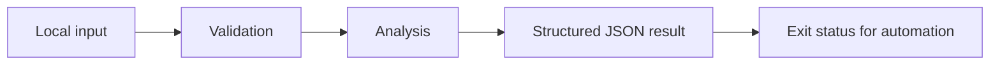

# Cloud Tag Audit

Offline resource inventory checks for ownership, environment, and cost allocation tags.

A focused Python command-line project with synthetic examples, explicit behavior, and regression tests. It runs locally without credentials or third-party packages.

## Run it

Requires Python 3.11 or newer.

```sh
python3 audit.py sample.json
python3 -m unittest -v
```

See [VALIDATION.md](VALIDATION.md) for the actual local test output and example result. GitHub Actions runs the suite on Python 3.11, 3.12, and 3.13.

## Design

Resources are provider-neutral JSON objects with unique identifiers and string-valued tags. Required keys must exist and contain nonblank values. Optional allowed-value lists enforce exact values. Keys and values are case-sensitive. Results include per-resource findings and a compliance ratio; an empty inventory reports null rather than a misleading 100%. Exit 1 indicates findings, and exit 2 indicates invalid input.



## Scope and limitations

No cloud resources are discovered or modified. You must export or assemble an inventory and validate that it covers the intended accounts and regions. This checks naming policy, not actual ownership, financial allocation, or regulatory compliance. The sample resource identifiers are fictional.

## Project layout

- `audit.py`: core functions and command-line entry point.
- `test_audit.py`: behavioral tests, including invalid inputs and boundary cases.
- `sample.json`: fictional example input or example notes.
- `VALIDATION.md`: reproducible local validation record.
- `.github/workflows/tests.yml`: automated tests with read-only repository permissions.

The core functions can be imported independently of the command line. Input files are never modified. Sample data is synthetic; the repository does not claim production usage or customer results.

MIT licensed.
